# Notebooks

These notebooks are the lab journal of Aquarelab. Each one tests a single idea,
records what happened and why, and feeds the decisions behind the code in `src/`.

They are kept on purpose, even when an approach is later replaced, so the
evolution of the project stays visible.

## Conventions

- Notebooks are numbered in the order they were created.
- Experimental code lives here first. Once it works and is reused, it moves to
  `src/aquarelab/` with tests, and the notebook imports it from there.
- Every notebook ends with a short conclusion. This file collects them.
- Figures are saved to `figures/`.
- Notebooks 01 to 03 ran on CPU. From notebook 04 on, training runs on a local
  GPU (NVIDIA RTX 5060 Ti, 16 GB, PyTorch 2.14 with CUDA 13.0). Results are only
  compared between runs on the same device, since CPU and GPU give slightly
  different numbers with the same seed.

## Index

| Notebook | Goal | Status |
|---|---|---|
| `01_recolor_kmeans.ipynb` | Baseline: k-means palette + Lab shift recoloring | Done |
| `02_palette_net_prototype.ipynb` | Check that a CNN can learn tone memberships by reconstruction | Done |
| `03_usage_floor.ipynb` | Test the usage floor loss and dead-tone-aware palette assignment | Done |
| `04_multi_image_training.ipynb` | Check the data pipeline and training on many images | Done |

---

## 01 · k-means baseline

**Setup.** Forest photo with fog, downscaled to 512 px. Palette of 5 tones
extracted with k-means in Lab space. Soft memberships computed from the distance
to each tone (temperature = 5). New palette assigned by luminance order.

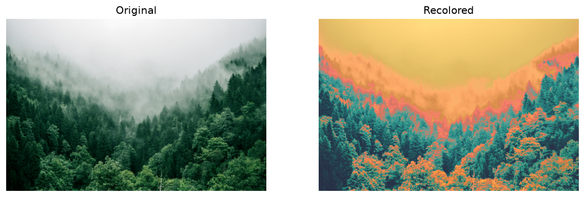

**What worked.** The Lab shift preserves light, shadow and texture. Trees keep
all their detail after recoloring.

**What failed.**

1. A reddish band appears in the middle of the fog. The fog is a smooth
   brightness gradient, and k-means cuts it into separate tones. Each tone is
   then shifted to a different color, which creates an artificial stripe.
2. Lit treetops get mixed with the fog. They have similar luminance, so k-means
   puts them in the same tone, even though they are different regions.

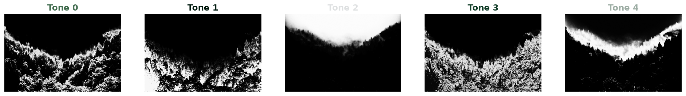

**Takeaway.** Clustering by color alone has no notion of what a region is.
That is the gap the CNN is meant to fill.

---

## 02 · PaletteNet prototype

**Setup.** ResNet-34 encoder (pretrained, via timm) with a U-Net style decoder
that outputs 8 tone memberships per pixel (softmax). Each tone's color is the
weighted mean of the pixels assigned to it. The image is rebuilt from palette and
memberships, and the network is trained only to make that reconstruction match
the input (L1 in Lab, plus a small entropy term). No labels.

This is an overfit test on a single image (256 px, 200 steps, Adam, lr 1e-3).
It checks that the idea works, not that the model generalizes.

**Why 5 seeds.** A first run without a fixed seed showed a smooth fog transition
with PaletteNet, while a second run with seed 0 showed stripes. The same model
was then trained with 5 seeds and compared against k-means with the same number
of tones (k = 8), the same new palette and the same metric, to separate model
behavior from initialization luck.

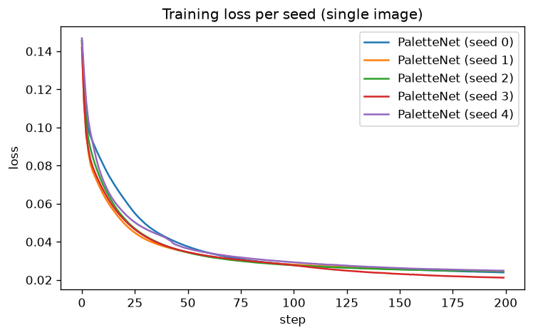

All seeds converge smoothly. Model, losses and gradients are wired correctly.

### Results

| Method | Reconstruction L1 (Lab, normalized) | Dead tones |
|---|---|---|
| k-means, k = 8 | **0.0124** | 0 |
| PaletteNet, seed 0 | 0.0199 | 2 |
| PaletteNet, seed 1 | 0.0212 | 3 |
| PaletteNet, seed 2 | 0.0213 | 3 |
| PaletteNet, seed 3 | 0.0170 | 1 |
| PaletteNet, seed 4 | 0.0212 | 3 |
| PaletteNet, mean | 0.0201 ± 0.0016 | 2.4 |

A tone is dead when it covers less than 1% of the image.

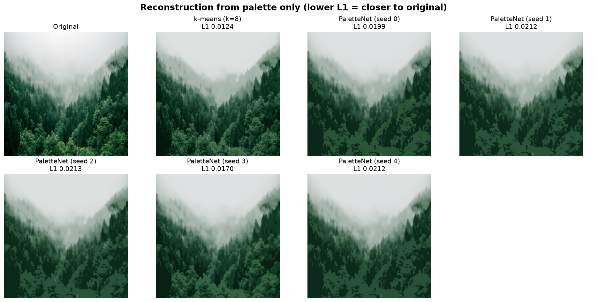

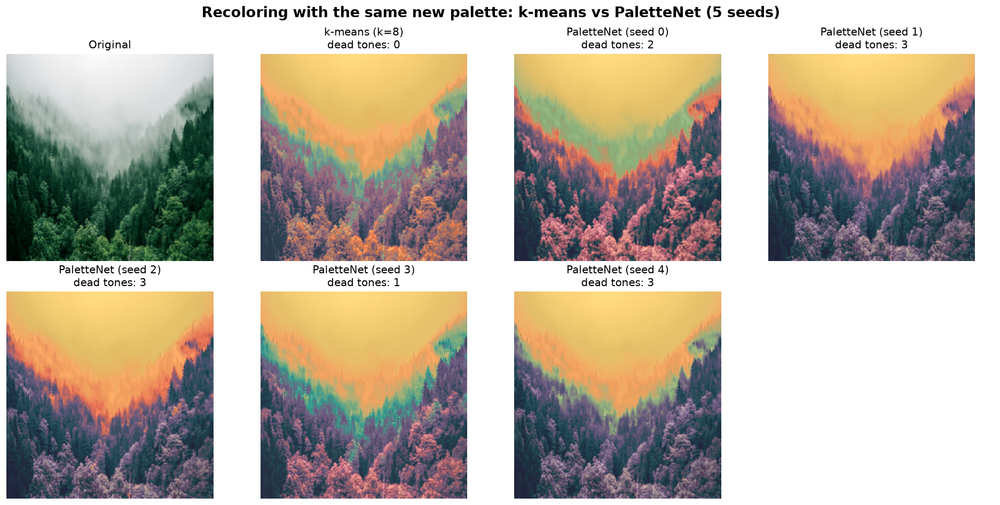

### Conclusions

**Dead tones happen in every seed and drive most of the error.** PaletteNet
loses 1 to 3 of its 8 tones, while k-means keeps all 8. Fewer dead tones means
lower error: seed 3 has 1 dead tone and the best L1, while the three seeds with
3 dead tones all sit around 0.0212.

**Reconstruction error is consistently worse than k-means.** The gap is several
times larger than the variation between seeds, so this is not noise. It is
expected, since k-means directly minimizes color distance.

**Stripes at the fog border are consistent behavior, not luck.** The three
brightest tones are nearly identical in every seed and in k-means: a thin band
(~6-7%), a transition band (~13%) and the fog itself (~26-27%). Both methods
slice the fog gradient into the same layers, and recoloring turns those layers
into visible stripes.

**Visual differences between seeds come from dead tones, not better
segmentation.** Seeds 1, 2 and 4 look smoother at the fog border, but they are
the ones with 3 dead tones. Luminance-based assignment still hands new colors to
dead tones, so they absorb the middle colors and the visible bands receive
neighboring warm colors. Seed 3, with almost all tones alive, shows the same
teal stripe as k-means.

**The one consistent advantage of PaletteNet is spatial coherence.** k-means
tone maps in the forest are speckled, because it groups pixels by color alone.
PaletteNet maps form continuous regions that follow treetops and groups of
trees. The cost: PaletteNet spends three tones on the fog gradient and leaves
only two or three for the forest, so the forest reconstruction is flat.

**Reconstruction error is not a valid measure of recoloring quality.** The final
evaluation needs a metric for region coherence, using COCO segmentation
annotations.

---

## 03 · Usage floor loss

**Setup.** Two fixes, now living in `src/aquarelab/`:

1. `usage_floor_loss`: penalizes any tone covering less than a minimum share of
   the image (2%), so no tone can die.
2. `assign_by_luminance(..., usage=...)`: dead tones keep their own color, and
   the live tones are spread across the full range of the new palette.

The same 5 seeds are trained twice, without and with the floor loss. Everything
else is identical, and both use the new assignment, so differences come from the
loss alone.

A new metric was added: **tones without region**, the tones that are never the
strongest tone in any pixel. It catches tones that meet the floor by spreading a
faint weight everywhere instead of owning a real region.

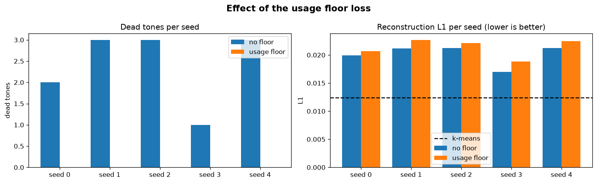

### Results

| Configuration | Reconstruction L1 | Dead tones | Tones without region |
|---|---|---|---|
| k-means, k = 8 | **0.0124** | 0 | 0 |
| No floor (5 seeds) | 0.0201 ± 0.0016 | 2.4 | 2.4 |
| Usage floor (5 seeds) | 0.0213 ± 0.0014 | 0.0 | 1.6 |

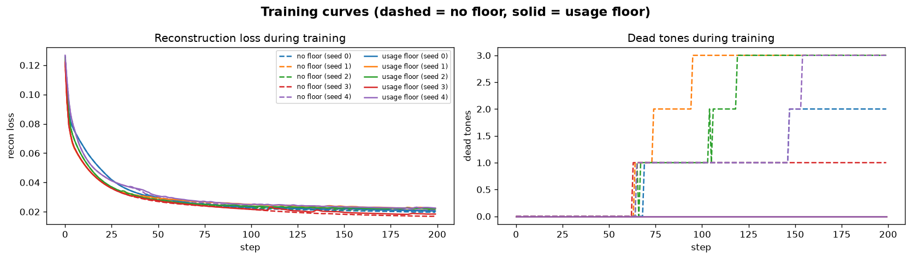

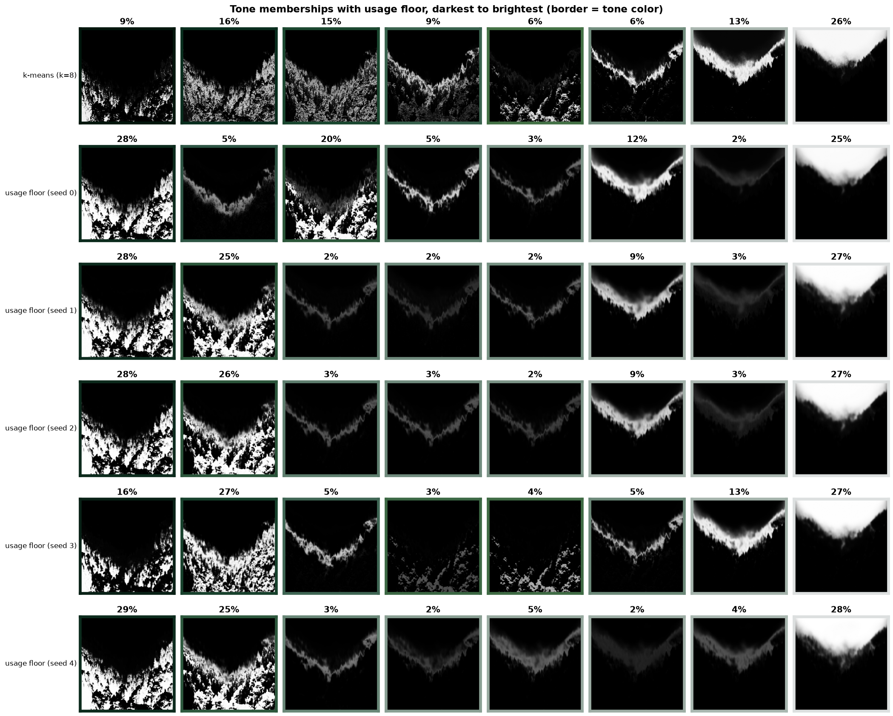

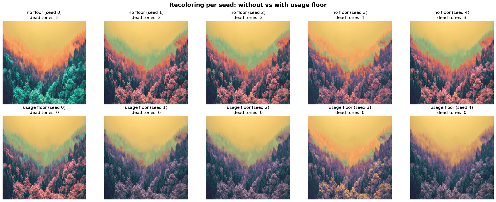

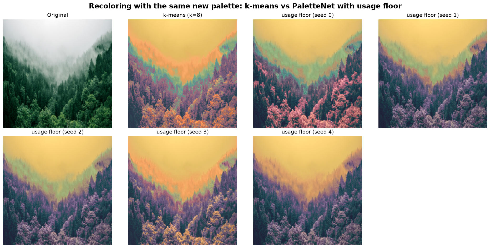

### Conclusions

**Sanity check passed.** The "no floor" runs reproduce notebook 02 exactly,
seed by seed, so the code moved to `src/` behaves the same as the notebook
version. A full rerun gave identical numbers, so the results are reproducible.

**The floor removes dead tones, but only half of the problem.** Dead tones drop
from 2.4 to 0, but tones without region only drop from 2.4 to 1.6. The network
met the floor by spreading a faint weight of the rescued tones along the fog
border. In the tone maps, seeds 1, 2 and 4 show several dim copies of the same
band, each sitting right at the 2-3% floor.

**Faint tones cost accuracy.** Reconstruction L1 gets worse in every seed.
Tones that own no region add color mixing without describing anything new.

**When rescued tones find real regions, it works.** In seed 3, two rescued tones
moved into the forest and cover lit treetops (3% and 4%). They show up as yellow
highlights in the recolored image. This is the intended behavior, but it
happened in only one seed.

**Tones die mid-training, not at the start.** Without the floor, tones die
between steps 60 and 150, after the main structure is already formed.

**Design issue for the dataset step.** A per-image floor forces every image to
use all 8 tones, even simple images that need fewer. The floor should apply to
usage averaged over a batch: every tone must be useful somewhere, not in every
image.

### Next steps

1. Change `usage_floor_loss` to work on batch-averaged usage. *(done in `src/`)*
2. Build the data pipeline and train on a dataset. Single-image tuning stops
   here, since the remaining questions depend on many images. *(pipeline done,
   tested in notebook 04)*
3. Track tones without region as a standard metric, since dead-tone count alone
   can be fooled.

---

## 04 · Multi-image training

**Setup.** First training on many images. 1,000 color images from COCO val2017,
random crops and flips, 128 px, batch of 8, 300 steps, one seed. The usage floor
is now averaged over the batch, so a tone may be absent from a simple image as
long as other images in the batch use it. Evaluation uses 8 held-out COCO images
and the forest image, none of them seen in training.

This is a pipeline check, not a benchmark. The same notebook was run on CPU and
on GPU (RTX 5060 Ti); the figures and numbers below come from the GPU run.

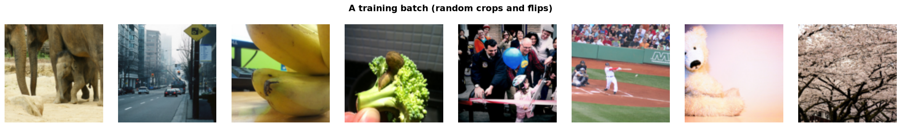

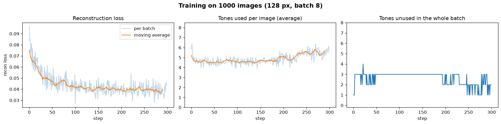

### Results

| Metric | CPU run | GPU run |
|---|---|---|
| Average time per step (300 steps) | 0.68 s | ~0.12 s |
| Holdout mean reconstruction L1 | 0.0434 | 0.0444 |
| Holdout mean tones used per image | 5.6 | 5.5 |
| Tones unused in the batch (most of training) | 3 | 3 |
| Worst holdout image (tennis), L1 | 0.0855 | 0.0940 |

A tone is used when it is the strongest tone in at least 1% of the pixels.

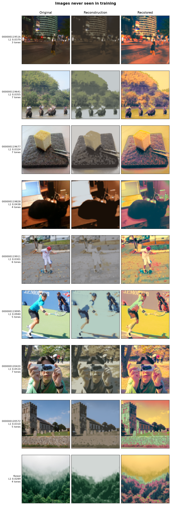

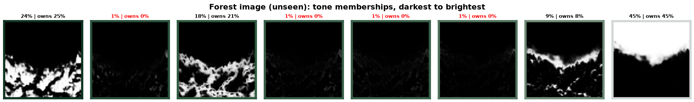

### Conclusions

**The pipeline works.** Batches arrive as expected: color images, random crops
and flips, values in [0, 1]. The GPU is only about 6x faster than the CPU here,
because images are still loaded one at a time on the CPU and the GPU waits for
data. Parallel data loading is needed for the full training run.

**Results differ between CPU and GPU with the same seed.** Small rounding
differences change the training path. All trends held on both devices. Runs
compared against each other must use the same device.

**The network learns from many images.** Reconstruction loss drops from 0.096
to about 0.04 in the first 100 steps, then plateaus. The per-batch curve is
noisy because each batch holds different images.

**It generalizes to unseen images.** Tone maps follow real objects: the cat is
one dark region, the cake separates from the plate, the church tower separates
from the sky, the tennis player separates from the court. On the forest image,
the fog became a single tone (45%) with one transition band (9%), instead of the
three layers seen in notebooks 02 and 03. Recoloring keeps texture on every image.

**The floor was fooled again, now at batch level.** Three tones stay unused
across the whole batch for most of training. On the forest image, four tones
have about 1% average weight but own 0% of the pixels. The floor measures
average weight, and the network meets it by spreading a faint weight instead of
giving those tones a region.

**More training may help.** Near the end, unused tones start dropping and tones
per image rise from about 4.5 to about 5.5. The network started recruiting new
tones right when training stopped.

**Saturated colors are the weakest case.** On the tennis image, the bright cyan
shirt and green court collapse into the same pale blue. With few active tones
and very varied images, there is no tone left for rare saturated colors.

### Next steps

1. Move training to a script (`train.py`) with parallel data loading, full-size
   images (256 px) and many more steps.
2. Compare entropy weights of 0.01 and 0.05 in that run. Stronger entropy makes
   memberships more decisive, so average weight and pixel ownership coincide
   and the floor can no longer be met by faint weights.
3. Keep tracking tones unused in the batch as the main health metric.