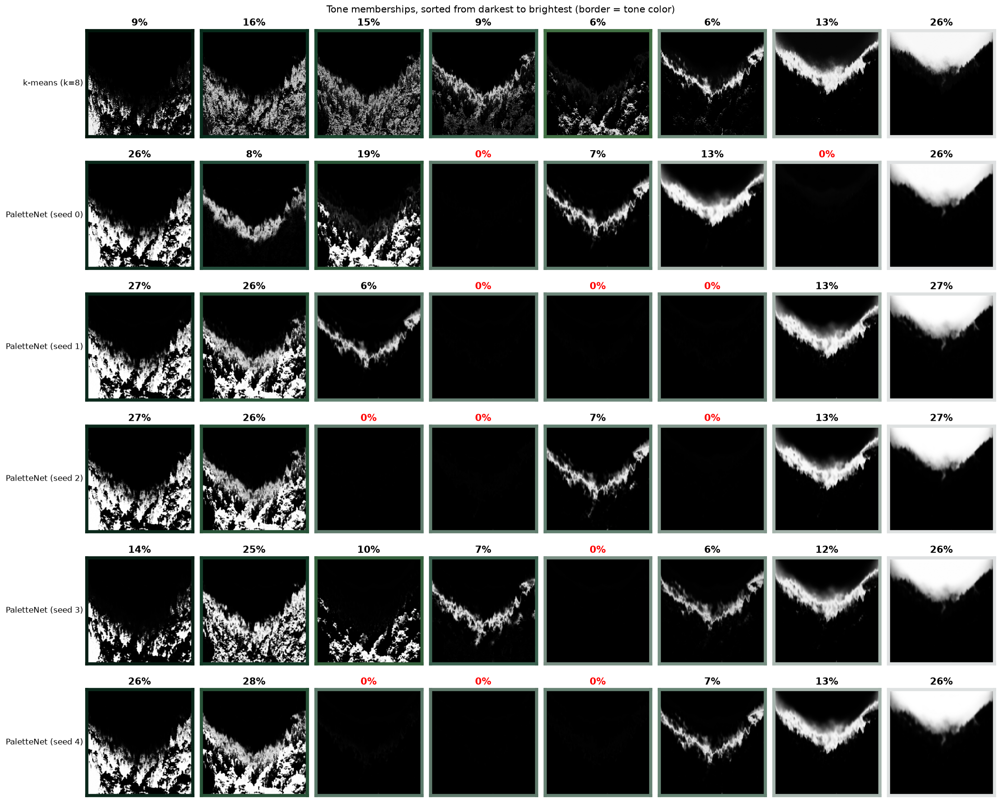
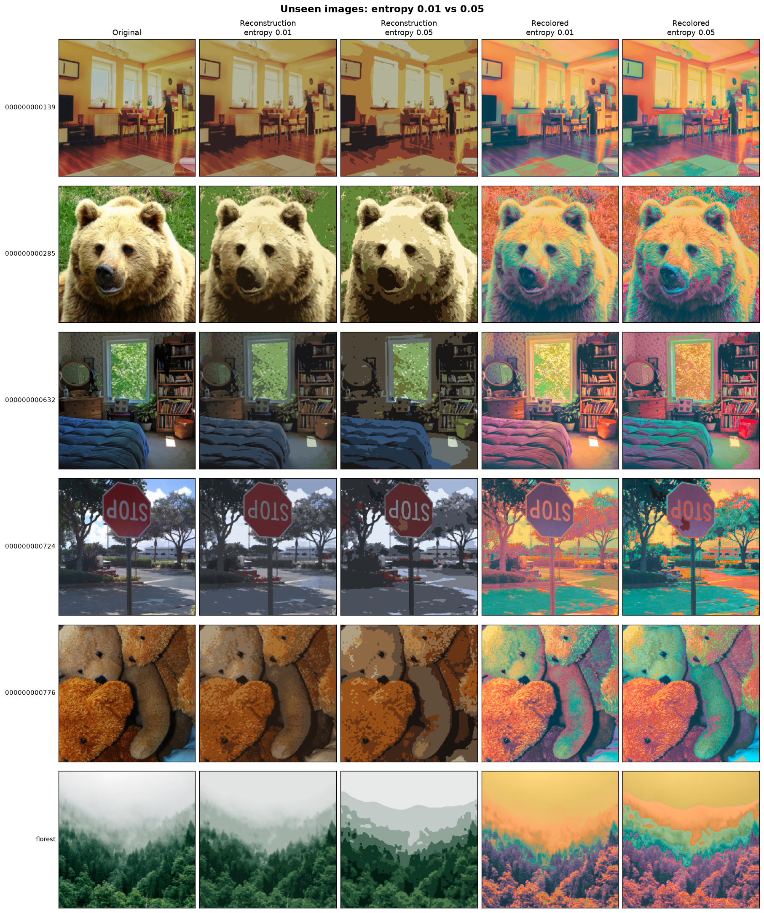

# Notebooks

The lab journal of Aquarelab. Each notebook asks one question, answers it with
experiments, and feeds the decisions behind the code in `src/`. This page
summarizes the path; full results, tables and figures are inside each notebook.

## The path in one table

| # | Question | Answer | Decision |
|---|---|---|---|
| 01 | Can a palette plus a Lab shift recolor a photo? | Yes, texture is kept. But k-means slices smooth gradients into stripes and mixes regions with similar brightness. | Use k-means as the baseline to beat. |
| 02 | Can a CNN learn tone maps with no labels? | Yes, on one image. Maps follow regions, unlike k-means, but 1 to 3 of 8 tones die. | Fix dead tones before scaling up. |
| 03 | Does a minimum-usage loss keep tones alive? | Partly. The network fakes it by spreading faint weights that own no pixels. | Measure tones by pixel ownership, and apply the floor per batch. |
| 04 | Does it train on many images? | Yes, and it generalizes to unseen photos. The floor is still fooled on short runs. | Move training to a script and run it at full scale. |
| 05 | Which entropy weight for the full model? | 0.01. No unused tones, lower error on 99% of images, and soft maps that remove stripes. | Entropy 0.01 is the reference model. |

---

## 01 · k-means baseline

**Question.** Can a palette extracted with k-means, plus a color shift in Lab
space, recolor a photo while keeping its light and texture?

**Answer.** The shift works: shadows and texture survive. Clustering does not:
the fog gradient is cut into separate tones that become stripes after
recoloring, and lit treetops are grouped with the fog because they share
brightness.

---

## 02 · PaletteNet prototype

**Question.** Can a CNN (pretrained ResNet-34 encoder, U-Net decoder) learn
per-pixel tone maps only by rebuilding the image from its own palette?

**Answer.** Yes. Trained on a single image with 5 seeds, its maps form coherent
regions where k-means is speckled. But every seed loses 1 to 3 tones, and both
methods still slice the fog into stripes. Reconstruction error is worse than
k-means, as expected, which showed that error alone does not measure
recoloring quality.

---

## 03 · Usage floor loss

**Question.** Does penalizing tones below a minimum share of the image keep
them alive?

**Answer.** Dead tones drop to zero, but the network cheats: rescued tones get a
faint weight spread along the fog, enough to meet the floor without owning any
pixel. This led to a new metric, **tone ownership** (the share of pixels where a
tone wins), and to moving the floor from each image to the whole batch, so
simple images are not forced to use all 8 tones.

---

## 04 · Multi-image training

**Question.** Does the data pipeline work, and does the network learn from many
images at once?

**Answer.** Yes. After a short run on 1,000 images, tone maps on unseen photos
follow real objects: a cat, a cake, a church tower. The floor is still fooled at
batch level in such a short run, and saturated colors are the weakest case.
CPU and GPU give slightly different numbers with the same seed.

---

## 05 · Entropy comparison

**Question.** Two full runs on COCO train2017 (118k images, 10k steps, Kaggle
T4), identical except for the entropy weight. Which one recolors better?

**Answer.** Both end with zero unused tones: many images plus a batch-level floor
solved the problem tracked since notebook 02. Entropy 0.01 wins clearly.

| Entropy | Reconstruction L1 | Tones per image | Decision |
|---|---|---|---|
| 0.01 | **0.0260** | 7.6 | 0.848 |
| 0.05 | 0.0334 | 7.8 | 0.988 |

Stronger entropy makes each pixel belong to a single tone (decision near 1).
That sounded desirable, but every hard boundary becomes a hard color edge.
With 0.01, tones overlap gradually, and the fog goes from yellow to orange to
purple with no stripes: the artifact seen since notebook 01 is gone.

---

## Open problems

- **Fine textures.** On fur, grass and plush, tones still follow light and dark
  within the texture, so recolored textures look speckled.
- **Rare saturated colors.** Very saturated regions can merge into a neighboring
  tone.
- **Measuring quality.** Reconstruction error does not capture recoloring
  quality. The final evaluation will compare against k-means using COCO
  segmentation annotations, to measure whether tones follow real regions.

## Notes

- Experimental code starts in a notebook and moves to `src/aquarelab/` with
  tests once it is reused.
- Notebooks 01 to 03 ran on CPU, notebook 04 on a local RTX 5060 Ti, and full
  training runs (05) on a Kaggle T4. Results are only compared between runs on
  the same device.